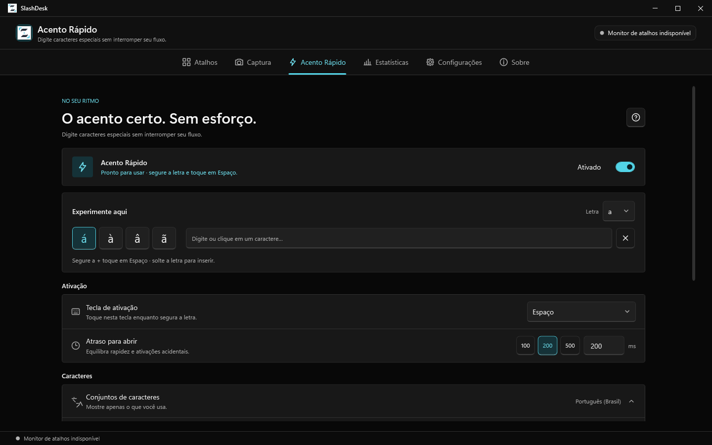
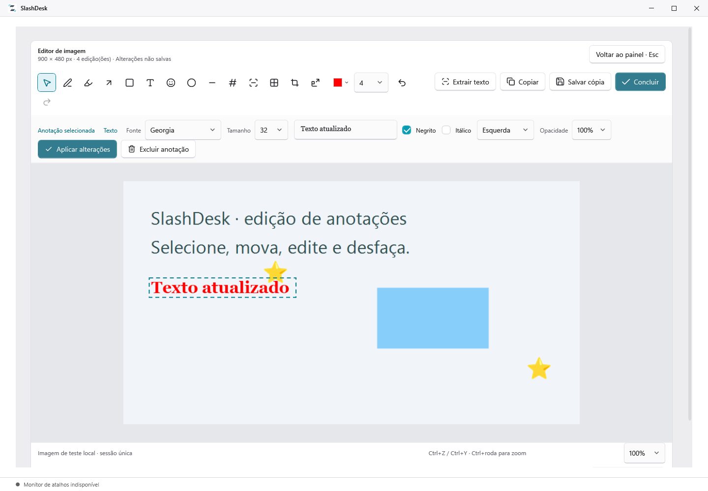

  

<h1 align="center">SlashDesk</h1>

Atalhos de texto, Acento Rápido, capturas e gravações locais para Windows.

  
  
  
  

  <a href="https://github.com/lucasllira/SlashText/releases/latest"><strong>Baixar versão estável</strong></a> ·
  <a href="SUPPORT.md">Ajuda</a> ·
  <a href="https://github.com/lucasllira/SlashText/issues/new/choose">Relatar problema ou sugerir melhoria</a>

Sem conta e sem upload obrigatório. O pacote portátil mantém os dados junto ao executável.
O repositório e o namespace continuam `SlashText` para preservar links e histórico; o produto é **SlashDesk**.

## Versões e downloads

Situação conferida em **17/10/2026**:

| Canal | Download | Situação |
|---|---|---|
| Estável | [v3.3.0](https://github.com/lucasllira/SlashText/releases/tag/v3.3.0) | Versão oferecida pelo atualizador |
| Pré-lançamento anterior | [v3.3.0-rc.1](https://github.com/lucasllira/SlashText/releases/tag/v3.3.0-rc.1) | Histórico de testes; substituído pela estável |

A **3.3.0 foi publicada como estável em 17/10/2026**. Ela reúne a nova interface, idiomas PT/EN/ES,
áudio nas gravações MP4 e melhorias de acessibilidade, segurança e recuperação.
Veja as [notas da 3.3.0](docs/releases/3.3.0.md) e a [validação/publicação #70](https://github.com/lucasllira/SlashText/issues/70).
A estável corresponde ao commit `834d7878ef02e2fc90572bd17df6aee898c1d3fd`; mudanças posteriores da main não alteram esse pacote.

## Conheça o aplicativo

| Recurso | Uso |
|---|---|
| Atalhos de texto | Expanda comandos como `/ola`, com texto simples/formatado, variáveis e categorias |
| Acento Rápido | Escolha caracteres enquanto segura uma letra e toca na tecla de ativação |
| Captura | Monitor, janela, região e captura longa, com anotações e histórico local |
| Gravação | GIF e MP4 de monitor, janela ou região, com pausa e prévia |
| Preferências | Temas Claro, Preto e Seguir o Windows, bandeja e backups |

**Interface da 3.3.0**, renderizada durante a preparação pelos controles WPF reais com dados fictícios.
Estas imagens são fixtures, com fonte e limites registrados. O monitor de atalhos fica indisponível
na fixture porque ela não instala hooks globais. [Origem e limites das imagens](docs/screenshots/README.md).

Editor de captura no tema claro

## Início rápido

1. Baixe `SlashDesk-X.Y.Z-portable-win-x64.zip` na release escolhida e extraia em uma pasta com permissão de escrita.
2. Abra `SlashDesk.exe`. O .NET já vem incluído no pacote Windows x64; o OCR nativo pode exigir [Visual C++ x64](docs/development.md#recursos-offline-e-visual-c).
3. Em **Atalhos**, crie um comando como `/teste` e experimente em outro aplicativo.
4. Em **Captura** e **Acento Rápido**, ajuste as opções ao seu fluxo. Consulte o [guia de uso](docs/user-guide.md) para recursos, variáveis e limitações do Windows.

Preserve a pasta **SlashDeskData** junto ao EXE ao mover ou atualizar o portátil.
Antes de substituir arquivos manualmente, feche o app pela bandeja e faça backup.
Veja [dados, atualização e recuperação](docs/storage-and-updates.md) e [suporte](SUPPORT.md).

## Conferir o download e a privacidade

Compare o ZIP com o `.sha256` publicado na mesma release. A estável 3.3.0 também oferece
[proveniência verificável do GitHub](docs/release-provenance.md); a versão anterior 3.2.0 não possui esse atestado.
O atualizador valida integridade, mas não verifica essa assinatura internamente.

Textos, imagens e gravações permanecem no computador. A verificação de atualização consulta o GitHub.
Para suspeitas de vulnerabilidade, use o [canal privado de segurança](SECURITY.md).

## Desenvolvimento

O código usa C#/WPF e .NET 10. Comece pelo [ambiente de build](docs/development.md),
[mapa do código](docs/code-map.md) e [perfis de teste](docs/testing.md).
Para contribuir, leia [CONTRIBUTING.md](CONTRIBUTING.md); agentes seguem [AGENTS.md](AGENTS.md).

## Guias e próximos passos

- [Guia de uso: recursos, variáveis, dados e limitações](docs/user-guide.md)
- [Índice completo da documentação](docs/README.md) e [registros históricos](docs/history.md)
- [Roadmap: lançamento e ideias futuras separados](docs/roadmap.md)
- [Organização de issues, labels e marcos](docs/project-navigation.md)

## Licença

[MIT](LICENSE). Os [avisos e licenças de terceiros](THIRD-PARTY-NOTICES.md)
podem ser consultados offline em **Sobre → Avisos de terceiros** na 3.3.0.
